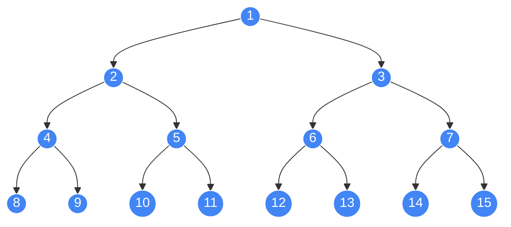
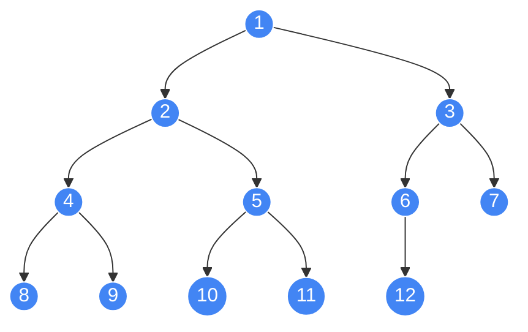
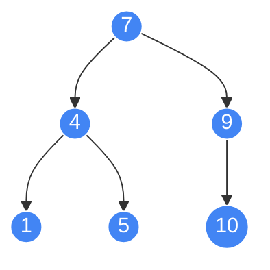
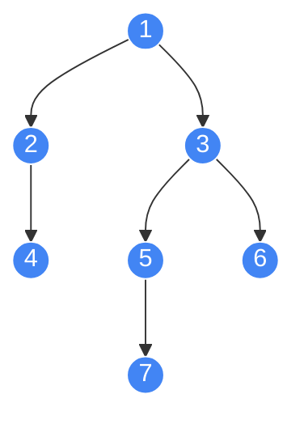

### 树的分类
#### 满二叉树
Perfect Binary Tree 即每一层节点都是满的，若深度为 h，则节点数为 $2^h-1$


#### 完全二叉树
Complete Binary Tree 指的是，每一层节点紧凑靠左排列，且除了最后一层，其他每层都是满的，是一种特殊的完全二叉树


> [!NOTE]
> 完全二叉树有性质：左右子树中至少有一个是满二叉树

#### 二叉搜索树
Binary Search Tree 即 BST，树中每个节点，其左子树每个节点值都小于这个节点值，右子树则是大于节点值


> [!NOTE]
> BST 常用于二分搜索某范围内节点

#### 高度平衡二叉树
Height-Balanced Binary Tree 的每个节点的左右子树高度差不超过 1


> [!NOTE]
> 若有 N 个节点，则平衡树的高度是 $O(\log N)$ ，可以保持提高增删改查的效率

如果可以在增删二叉树节点时对树结构进行一些调整，可以让树高度始终是平衡的，此时为自平衡树
	如红黑树即为自平衡的 BST

> 保持树的平衡性最关键的是**旋转**操作

### 树的表示

链表实现：
```python
class Tree:
    def __init__(self, val) -> None:
        self.val = val
        self.left = None
        self.right = None
```

哈希表实现：
如上面高度平衡二叉树可用哈希表表示为
```python
tree = {
    1: [2, 3], 
    2: [4], 
    3: [5, 6], 
    5: [7]
}
```
这种表示方式即为**邻接表**

数组实现：
静态数组可用来表示完全二叉树，若节点数为 $N$，则大约需开 $4N$ 空间的数组，结构为：
	1. 从 1 开始给节点编号
	2. 编号 $p$ 的左右节点分别为 $2p$ 和 $2p+1$

### 树的遍历

#### DFS 递归
DFS 常用来穷举所有路径
二叉树的遍历框架为
```python
def traverse(root):
    if root:
        # pre-order
        traverse(root.left)
        # in-order
        traverse(root.right)
        # post-order
```

> [!NOTE] 性质
> BST 的中序遍历结果是有序的，这是 BST 的重要结果

#### BFS 层序
BFS 常用来寻找最短路径
BFS 即通过队列，一层一层遍历二叉树，有三种写法
1. 最简单但不能记录深度
2. 最常用可记录深度
3. 最灵活可用于复杂场景

> BFS 可用于求最小深度（叶节点深度最小值）：只需层遍历到叶节点即可返回 depth，此时就是最小深度
##### 法一
```python
from collections import deque

def traverse(root):
    if root:
        queue = deque([root])
        while queue:
            cur = queue.popleft()
            print(cur.val)

            if cur.left:
                queue.append(cur.left)
            if cur.right:
                queue.append(cur.right)
```

##### 法二
```python
from collections import deque

def traverse(root):
    if root:
        queue = deque([root])
        depth = 1

        while queue:
            for _ in range(len(queue)):
                cur = queue.popleft()
                print((depth,cur.val))

                if cur.left:
                    queue.append(cur.left)
                if cur.right:
                    queue.append(cur.right)
            depth += 1
```

##### 法三
法二中 depth 加 1 可理解为每条树枝权重为 1，depth 即为根节点到此节点的路径权重和。在一般情况下，可添加一个 State 类让每个节点维护自己的路径权重和：
```python
from collections import deque

class State:
    def __init__(self, node, depth) -> None:
        self.node = node
        self.depth = depth

def traverse(root):
    if root:
        queue = deque(State(root, 1))
        while queue:
            cur = queue.popleft()
            print((cur.depth, cur.node.val))

            if cur.left:
                queue.append(State(cur.node.left, cur.depth + 1))
            if cur.right:
                queue.append(State(cur.node.right, cur.depth + 1))
```

#### N 叉树（森林）的遍历

N 叉树节点可以有任意多子结点，定义如：
```python
class Tree:
    def __init__(self, val, children=None) -> None:
        self.val = val
        self.children = children or []
```

N 叉树有前序遍历和后序遍历，方法和前文一样；层序遍历如下：
```python
from collections import deque

def bfs(root):
    if root:
        res = []
        queue = deque([root])

        while queue:
            level = []

            for _ in range(len(queue)):
                cur = queue.popleft()

                level.append(cur.val)
                queue.extend(cur.children)

            res.append(level)

        return res
```

#### 递归遍历的迭代栈

前序遍历的迭代栈版本如下：
```python
def dfs(root):
	res = []
	stack = [root] if root else []
	while stack:
		cur = stack.pop()
		res.append(cur.val)
		stack.extend(reversed(cur.children))
	return res
```

后序遍历的迭代栈普通思路是使用 visited 标记是否已访问，栈元素 (cur, visited)

考虑到栈 LIFO 特性，对“根左右”反转即为“左右根”后序
```python
def dfs(root):
	res = []
	stack = [root] if root else []

	while stack:
		cur = stack.pop()
		res.append(cur.val)
		stack.extend(cur.children)

	return res[::-1]
```

> [!NOTE] `[::-1]` 与 `[:-1]` 区别：
> 如 `res = [1,2,3,4,5]`
> 1.  `res[::-1] = [5,4,3,2,1]`
> 2.  `res[:-1] = [1,2,3,4]`


