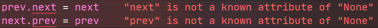
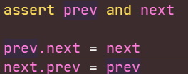

Python 静态检查工具如 Pylance，可以避免各种类型错误的发生

> 开启类型静态检查：
> settings->搜索 typechecking，将 off 改为 basic 即可

如定义类后构造实例，给实例添加构造函数中没有的属性会静态报错（但语言层面可以运行）

又如返回类型可能为类也可能为 None：（Unknown|None） 但代码本身保证了不会为 None，此时静态检查也会报错（不能推断运行时），此时可以**在报错前一行添加 assert 来缩短静态类型范围**

加入 assert 前：

加入 assert 后：

> [!Attention]
> 在 OJ 环境应删去 assert

