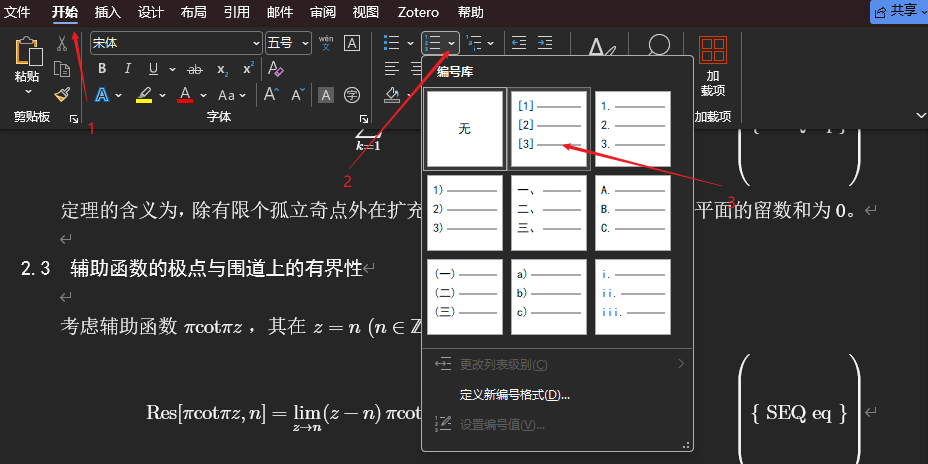
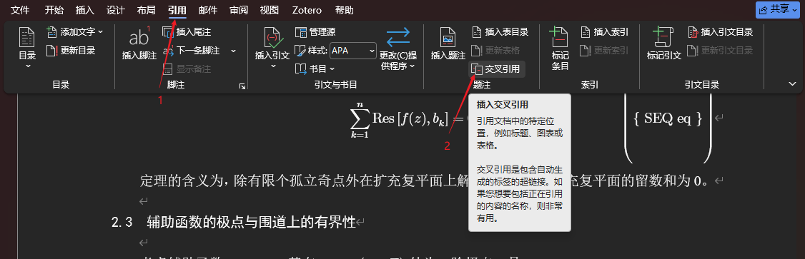
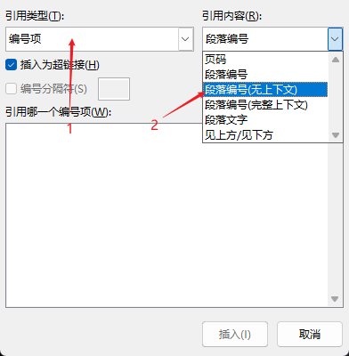
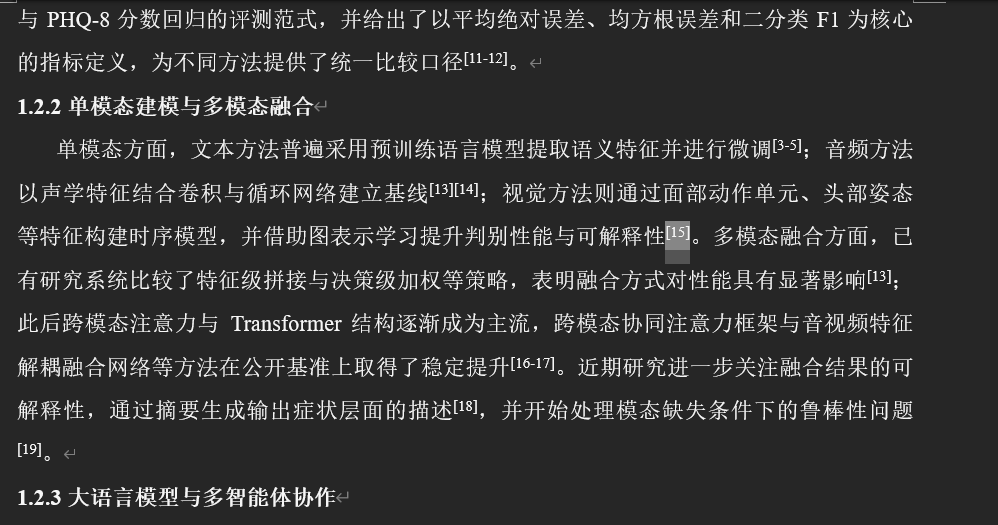

先全选所有参考文献，按图中指示自动编号

> 如果没有方括号，需要在下栏定义新编号格式手动定义

把光标置于需要引用的地方，按图中指示找到交叉引用


在交叉引用页面，选择引用类型为编号项，引用内容为段落编号（无上下文），再在下栏选择引用的文献编号即可


最后选中引用项，按 Ctrl+Shift+=将引用项移至右上角即可


若要实现 `[13][14]` 变为 `[13-14]` 的效果，需要选中 `[13]`，在右键菜单选择「切换为域代码」，得到
```
{REF _Ref243509186 \n \h}
```
在 `\h`（hide）后加上 `\# "[0"`

同理对 `[14]` 类似操作，加上 `\# "0]"`，最终更新域得到 `[1314]`，在其中手动加入 `-` 或 `,` 即可

> [!Important]
> 使用到的域代码：
> ```
> \# "[0" 保留左括号
> \# "0"  只保留中间数字
> \# "0]" 保留右括号
> ```
> 借助 `\# "0"` 可做到类似 `[14,16,18]` 效果

