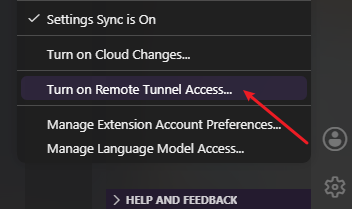

### 官方 Tunnel

本质上是启动了 code-server，因此不是完整的 VSCode

临时：如下图打开/关闭 Tunnel


或者注册为后台服务：
安装后开机自启
```bash
code tunnel service install
```
卸载服务
```bash
code tunnel service uninstall
```
彻底解绑
```bash
code tunnel unregister
```

> [!Important]
> 下载的完整服务程序在用户/.vscode/cli/servers 中，旧包不会自动清理占用会变大，需要自行清理
> 

### SSH

VSCode 通过 OpenSSH 连接远程服务器时，会在服务器中下载 .vscode-server 文件夹作为服务程序